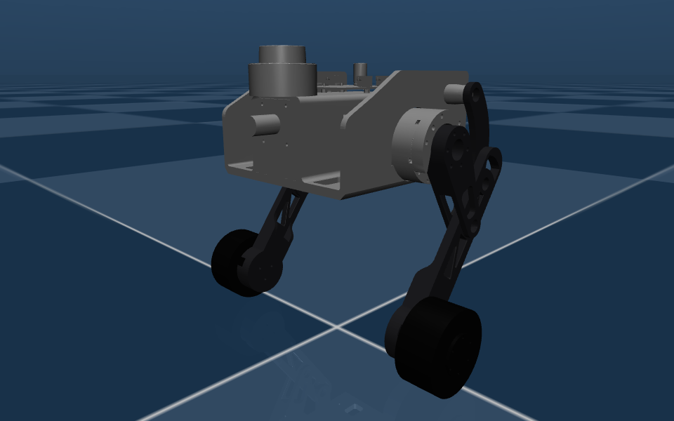
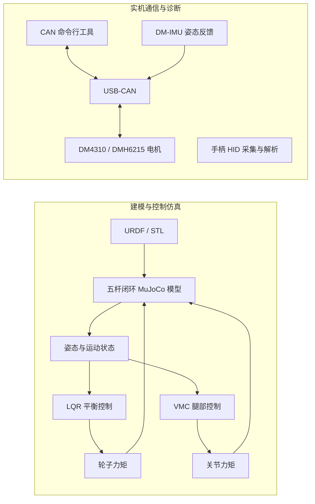

# RhinoPi X1

基于五杆闭环机构的轮腿机器人项目，结合 MuJoCo 建模、LQR + VMC 控制仿真与 CAN 电机、IMU 姿态反馈联调。



*主图：由项目 URDF / STL 生成的 MuJoCo 模型渲染。*

## 项目目标

围绕轮腿机器人机构与控制系统，建立可用于调参和验证的五杆闭环仿真模型，并连接电机控制、姿态采集与实机诊断链路。

- **机构建模**：从 URDF / STL 构建 MuJoCo 模型，保持五杆连杆的闭环约束。
- **控制仿真**：采用 LQR 处理平衡与轮子输出，采用 VMC 处理腿部高度和力矩分配。
- **实机联调**：通过 CAN 接入电机状态和 DM-IMU 姿态反馈，配合命令行工具与手柄 HID 采集进行调试。

## My Contribution

李浩涵（Haohan Li）在本项目中的参与工作：

- 参与五杆机构建模、模型关系核对与模型调试。
- 参与 CAN 电机通信与 IMU 姿态反馈的实机联调，协助排查通信和系统集成问题。
- 协助 LQR + VMC 仿真的参数调试与运行观察。

## System Architecture



| 组成 | 对应源码 |
| --- | --- |
| 五杆闭环模型生成 | [`sim/model_xml.py`](sim/model_xml.py)、[`sim/robot/robot.urdf`](sim/robot/robot.urdf) |
| LQR + VMC 控制仿真 | [`sim/controllers/combined.py`](sim/controllers/combined.py)、[`sim/controllers/balance_lqr.py`](sim/controllers/balance_lqr.py)、[`sim/controllers/vmc.py`](sim/controllers/vmc.py) |
| CAN 电机与 IMU 联调 | [`control/can_tool.py`](control/can_tool.py)、[`control/damiao_can/`](control/damiao_can/) |
| 手柄 HID 采集 | [`scripts/collect_gamepad_hid_mapping.py`](scripts/collect_gamepad_hid_mapping.py) |

## 关键结果

- 完成五杆闭环 MuJoCo 模型搭建，模型生成管线包含左右腿闭环连杆约束。
- 打通 CAN 电机通信与 IMU 姿态反馈链路，形成串口发现、总线监听、姿态读取及电机保守测试入口。
- 建立 LQR + VMC 控制仿真与调参流程，结合模型状态进行运行观察和验证。

## 技术文档

以下保留项目的 HID、CAN 和实机测试操作文档。

## 手柄 HID 数据帧采集

用于未知 Xbox/手柄 HID 报文分析。程序会引导你依次松开手柄、推左摇杆、按 LT/RT 和常用按钮，记录原始 HID 报文，并自动生成解析映射。

采集并生成映射：

```bash
uv run python scripts/collect_gamepad_hid_mapping.py
```

按提示选择 HID 设备，然后在每一步先保持指定动作，再按回车开始采集。输出文件会写到 `tmp/`：

- `tmp/gamepad_hid_capture_*.json`：原始报文记录。
- `tmp/gamepad_hid_mapping_*.json`：自动推断出的字段映射。
- `tmp/decode_gamepad_hid_*.py`：使用该映射的解码入口。

用生成的映射实时查看转换结果：

```bash
uv run python scripts/decode_gamepad_hid.py --mapping tmp/gamepad_hid_mapping_YYYYMMDD_HHMMSS.json
```

输出格式：

```text
lx=+0.000 ly=+0.842 lt=0.000 rt=0.000 buttons=-
lx=-0.716 ly=+0.000 lt=0.000 rt=1.000 buttons=a
```

只采集摇杆和扳机：

```bash
uv run python scripts/collect_gamepad_hid_mapping.py --skip-buttons
```

如果每步报文太少，把采集时间加长：

```bash
uv run python scripts/collect_gamepad_hid_mapping.py --duration 2.0
```

## 实机步骤

列出串口：

```bash
uv run python -m control.can_tool list-ports
```

只读监听 CAN 总线：

```bash
uv run python -m control.can_tool sniff --backend dm_usbcan --duration 1.0
```

## 双电机保守测试命令

同时测试 `0x02 dm4310_left` 和 `0x04 dmh6215_left`：

```bash
uv run python -m control.can_tool pair conservative-spin --backend dm_usbcan --duration 0.3 --period 0.05 --velocity 0.2 --wheel-velocity 0.2 --torque 0.0 --telemetry
```

只给 `0x04 dmh6215_left` 轮电机 MIT 速度目标，`0x02 dm4310_left` 发送零速度：

```bash
uv run python -m control.can_tool pair conservative-spin --backend dm_usbcan --duration 0.3 --period 0.05 --velocity 0.0 --wheel-velocity 0.2 --torque 0.0 --telemetry
```

手动发送零输出收尾：

```bash
uv run python -m control.can_tool group zero --backend dm_usbcan --duration 0.2 --period 0.05 --telemetry
```

参数含义：

- `--backend dm_usbcan`：使用达妙 USB-CAN 串口后端，默认端口为 `/dev/cu.usbmodem00000000050C1`。
- `--duration`：非零控制持续时间，当前硬限制为 `0 < duration <= 10` 秒；实机冒烟建议先用 `0.1` 到 `0.5` 秒。
- `--period`：控制帧发送周期，单位秒；建议实机保守测试先用 `0.05`。
- `--velocity`：`0x02 dm4310_left` 的 MIT 速度命令，当前硬限制为 `abs(velocity) <= 5.0`。
- `--wheel-velocity`：`0x04 dmh6215_left` 的 MIT 速度目标，当前硬限制为 `abs(wheel_velocity) <= 5.0`。
- `--torque`：`0x02 dm4310_left` 的 MIT torque feed-forward，当前硬限制为 `abs(torque) <= 1.0`；实机冒烟默认保持 `0.0`。
- `--telemetry`：控制期间打印反馈帧，包含 `state`、`position`、`velocity`、`torque`。

注意：多行 shell 命令中每行末尾的 `\` 后面不能有空格，否则 zsh 会把下一行参数当成单独命令。
